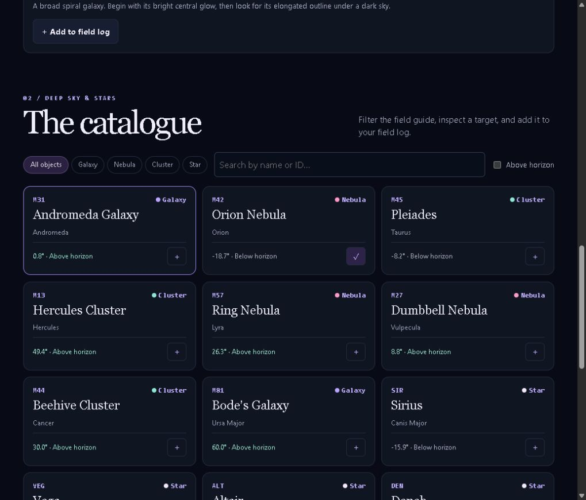

# Nocturne · Night Sky Atlas

An interactive observing atlas with a custom Canvas sky chart, a searchable object catalogue and a field log stored in the browser.



## Run locally

```sh
python -m http.server 8080 --directory dist
```

Open [http://127.0.0.1:8080](http://127.0.0.1:8080). Choose a city, set a UTC time and move the offset slider. Select an object on the chart or in the catalogue, add it to your field log and export the list as CSV.

## Implementation

- `astro.js` transforms approximate J2000 equatorial coordinates into altitude and azimuth using local sidereal time.
- `chart.js` renders a polar horizon projection with north at the top and east on the left. The illustrated hero galaxy is generated from a seeded particle field.
- `app.js` connects observer controls, filters, the chart, persistent bookmarks and CSV export.

The atlas includes a curated selection of 16 targets. Its model omits precession, refraction, weather, terrain and daylight. The chart indicates geometric position and is intended for exploration.

Reference material is available in [NASA’s Hubble Messier catalogue](https://science.nasa.gov/mission/hubble/science/explore-the-night-sky/hubble-messier-catalog/) and the [IAU constellation guide](https://www.iau.org/IAU/Astronomy-FAQs/Constellations.aspx).

## Checks

```sh
node --test test/astro.test.mjs
```
